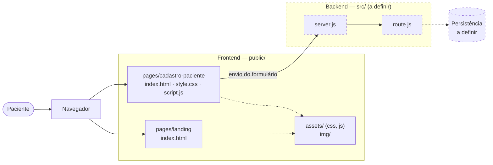

# Arquitetura

Este documento apresenta a estrutura técnica atual do Fibrosync e suas principais fronteiras.

## Fontes relacionadas

- [Projeto FIB no Jira](https://aluno-team-zylgcwkh.atlassian.net/jira/software/projects/FIB/summary)
- [Espaço do Fibrosync no Confluence](https://aluno-team-zylgcwkh.atlassian.net/wiki/spaces/F/overview)
- [Decisões de arquitetura](../decisions/overview.md)

## Contexto do sistema

<!-- Descrever os usuários, sistemas externos e responsabilidades do Fibrosync. -->

## Visão geral

<!-- Atualizar o diagrama quando os componentes e integrações forem definidos. -->

## Componentes

| Componente | Responsabilidade | Dependências |
|---|---|---|
| — | A definir | — |

## Fluxo de dados

<!-- Registrar apenas os fluxos relevantes para compreender a arquitetura. -->

## Integrações externas

| Integração | Finalidade | Referência |
|---|---|---|
| — | A definir | — |

## Restrições e requisitos arquiteturais

- A definir.

## Decisões relacionadas

As decisões e suas ligações com Jira, Confluence, Figma e Pull Requests estão no [mapa de ADRs](../decisions/overview.md).
